<p align="center">
  
</p>

<p align="center">
  <strong>Your Digital World. Protected from Every Angle.</strong><br>
  <em>Next-Generation AI Cybersecurity, Threat Relationship Graphing & Decentralized Blockchain Attestation</em>
</p>

<p align="center">
  <a href="https://sayanghosh67.github.io/CyberTrust-360/"></a>
  <a href="#-quick-start--installation"></a>
  <a href="https://github.com/sayanghosh67/CyberTrust-360/actions"></a>
  <a href="#-team-technix-pro"></a>
</p>

<p align="center">
  
  
  
  
  
  
  
  
  
  
</p>

---

## 📌 Table of Contents

- [🎯 Executive Summary & Problem Statement](#-executive-summary--problem-statement)
- [✨ The CyberTrust 360 Solution](#-the-cybertrust-360-solution)
- [🌐 Live Deployment & Interactive Demo](#-live-deployment--interactive-demo)
- [🏛️ System Architecture & Data Pipelines](#️-system-architecture--data-pipelines)
  - [High-Level Architecture](#high-level-architecture)
  - [End-to-End Threat Investigation Pipeline](#end-to-end-threat-investigation-pipeline)
  - [AI Scam DNA & Prompt Injection Defense Pipeline](#ai-scam-dna--prompt-injection-defense-pipeline)
  - [Blockchain Attestation & Tamper Detection Flow](#blockchain-attestation--tamper-detection-flow)
- [🛡️ Core Platform Modules](#️-core-platform-modules)
  - [1. Deep URL Investigation Engine](#1-deep-url-investigation-engine)
  - [2. AI Scam DNA Intelligence](#2-ai-scam-dna-intelligence)
  - [3. Threat Relationship Intelligence Graph](#3-threat-relationship-intelligence-graph)
  - [4. Blockchain Trust Center & Zero-PII Attestation](#4-blockchain-trust-center--zero-pii-attestation)
  - [5. Golden Hour Situational Incident Guidance](#5-golden-hour-situational-incident-guidance)
- [📸 Visual Tour & Gallery](#-visual-tour--gallery)
- [🔐 Security, Privacy & Responsible AI Principles](#-security-privacy--responsible-ai-principles)
- [📂 Repository Structure](#-repository-structure)
- [⚡ Quick Start & Installation](#-quick-start--installation)
- [🧪 Automated Test Suite](#-automated-test-suite)
- [🎬 5-Minute Hackathon Demo Script](#-5-minute-hackathon-demo-script)
- [👥 Team TECHNIX PRO & Acknowledgments](#-team-technix-pro--acknowledgments)
- [📄 License & Disclaimers](#-license--disclaimers)

---

## 🎯 Executive Summary & Problem Statement

Modern cybercrime operates at unprecedented speed and sophistication, targeting both technical vulnerabilities and human psychology:

| Modern Cyber Threat Vector | The Real-World Impact | How Conventional Tools Fail |
| :--- | :--- | :--- |
| **Weaponized Web Infrastructure** | Fraudsters register typosquatting domains (e.g. `paypa1-update.com`) with valid Let's Encrypt certificates to mimic legitimate brands. | Standard scanners show a green padlock because TLS exists, confusing victims into false trust. |
| **Social Engineering & Indian Digital Scams** | Aggressive coercion via SMS/WhatsApp/Telegram (Fake Electricity Cutoff, Digital Arrest, UPI PIN inversion, KYC blocks, Task Scams). | Existing security scanners cannot parse Indian fraud tactics, regional payment handles (UPI VPAs), or burner numbers. |
| **Fragmented Threat Evidence** | Scammers reuse shared telephone numbers, payment VPAs, and hosting servers across hundreds of distinct scam campaigns. | Single-URL scanners evaluate threats in isolation, failing to reveal that a new domain belongs to an active crime syndicate. |
| **Fragile Audit Trails & Legal Disputes** | Incident response reports are easily modified or disputed after an attack, hindering cybercrime prosecution and insurance claims. | Centralized database logs lack cryptographic provenance and immutable timestamping. |
| **Paralysis During The "Golden Hour"** | Victims lose critical minutes after clicking a phishing link or transferring money because they do not know what immediate steps to take. | Scanners provide binary "Malicious/Safe" alerts without actionable, situational emergency protocols. |

---

## ✨ The CyberTrust 360 Solution

**CyberTrust 360** transforms reactive cybersecurity into an **integrated 360° digital defense ecosystem** built in a 48-hour hackathon sprint by **Team TECHNIX PRO**:

1. **Non-Invasive Technical URL Forensics**: Audits DNS records (A, AAAA, MX, TXT, NS), TLS certificate lifespan, HTTP security headers (HSTS, CSP, X-Frame-Options), and typosquatting with zero active probing.
2. **AI Scam DNA Sequencing**: Unmasks linguistic manipulation, identifies coercive tactics, extracts actionable threat indicators (burner numbers, UPI handles, URLs), and fences prompts against adversarial injection.
3. **Interactive Threat Relationship Graph**: An interactive React Flow visualization correlating disparate scam reports by shared infrastructure, distinguishing verified connections from inferred playbook patterns.
4. **Decentralized Blockchain Attestation**: Anchors cryptographic SHA-256 fingerprints on an EVM smart contract (`CyberTrustReportRegistry.sol`) with real-time tamper detection while storing **Zero Personal Identifiable Information (Zero PII)** on-chain.
5. **Golden Hour Incident Response**: Situational step-by-step emergency workflows guiding victims through immediate containment and direct reporting to **India's National Cyber Crime Helpline 1930** and **cybercrime.gov.in**.

---

## 🌐 Live Deployment & Interactive Demo

- **🚀 Live Production Web Application**: [https://sayanghosh67.github.io/CyberTrust-360/](https://sayanghosh67.github.io/CyberTrust-360/)
- **🎥 Pitch Deck & Presentation**: [CyberTrust360_PitchDeck_Remediated.pptx](docs/CyberTrust360_PitchDeck_Remediated.pptx)
- **📋 Video Storyboard & Script**: [DEMO_VIDEO_STORYBOARD.md](docs/DEMO_VIDEO_STORYBOARD.md)
- **📐 Technical Architecture Deep Dive**: [docs/ARCHITECTURE.md](docs/ARCHITECTURE.md)

---

## 🏛️ System Architecture & Data Pipelines

### High-Level Architecture

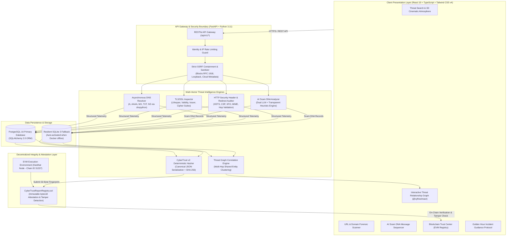

---

### End-to-End Threat Investigation Pipeline

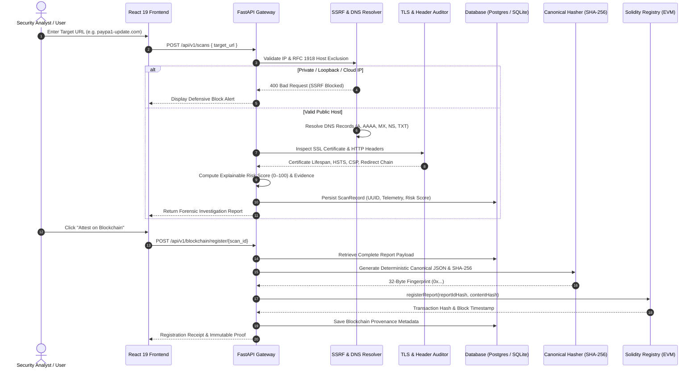

---

### AI Scam DNA & Prompt Injection Defense Pipeline

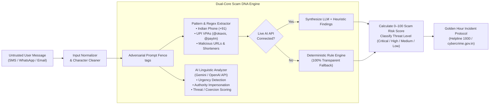

---

### Blockchain Attestation & Tamper Detection Flow

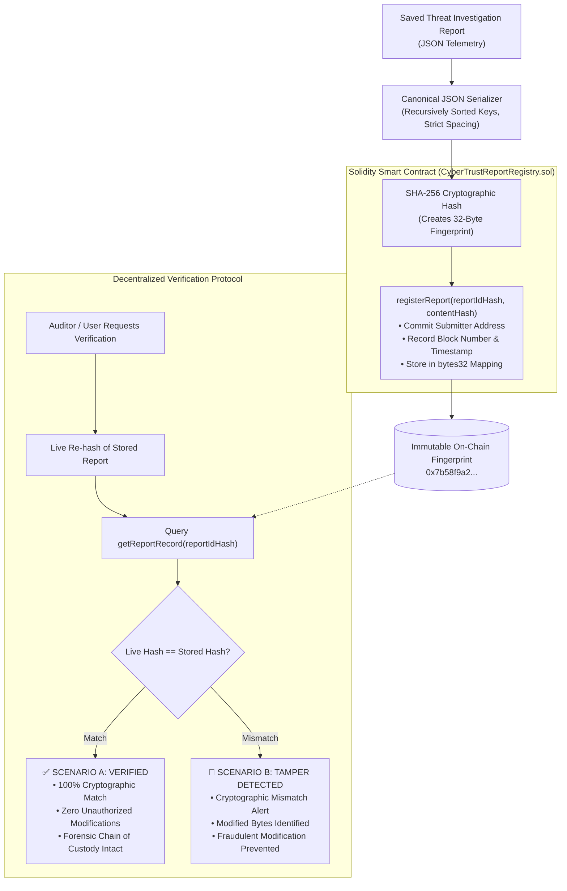

---

## 🛡️ Core Platform Modules

### 1. Deep URL Investigation Engine
- **Non-Invasive Architecture**: Concurrently inspects target infrastructure without launching invasive exploitation attempts.
- **Asynchronous DNS Analysis**: Resolves IPv4 (A), IPv6 (AAAA), Mail Exchangers (MX), Name Servers (NS), and Verification Records (TXT) via `dnspython` and Cloudflare DNS-over-HTTPS.
- **TLS/SSL Lifespan Auditing**: Extracts certificate issuer, subject alternate names (SAN), remaining lifespan (days to expiry), and cipher suites. Detects short-lived certificates commonly used in ephemeral phishing domains.
- **HTTP Security Header Scrutiny**: Inspects HSTS (`Strict-Transport-Security`), Content Security Policy (`CSP`), `X-Frame-Options` (Clickjacking prevention), and `X-Content-Type-Options`.
- **Typosquatting & Homoglyph Detection**: Identifies character-substitution attacks against major brands (PayPal, State Bank of India, HDFC, Google, Netflix) using Levenshtein distance metrics.

### 2. AI Scam DNA Intelligence
- **Indian Digital Fraud Defense**: Specialized heuristics detect prevalent Indian digital crime vectors:
  - **Fake KYC Updates**: Threats of bank account freezing within 24 hours.
  - **UPI PIN Traps**: Fake refund/cashback requests where victims are tricked into entering their PIN to "receive" funds.
  - **Electricity Bill Disconnection**: Phishing SMS impersonating electricity boards.
  - **Digital Arrest Scams**: Threatening calls/messages claiming customs or police detainment.
  - **Part-Time Job / Telegram Tasks**: Work-from-home tasks demanding prepaid deposits.
- **Prompt Injection Defense**: Untrusted messages are securely isolated inside XML delimiters (`<untrusted_user_message>`), neutralizing adversarial prompt manipulation attempts.
- **Dual-Mode AI with Transparent Fallback**: Seamlessly queries live LLMs (Gemini / OpenAI). If external APIs are unavailable or omitted, it gracefully falls back to deterministic rule-based analysis with **100% transparent attribution**.

### 3. Threat Relationship Intelligence Graph
- **Interactive Multi-Hop Visualization**: Powered by `@xyflow/react` with custom nodes, anti-overlap layout, and interactive pan/zoom.
- **7 Distinct Entity Types**: URL, Domain, IP Address, Scam Message, Brand, Phone Number, and UPI Payment Handle.
- **Clear Edge Semantics**:
  - **Solid Green Edges**: Verified shared technical indicators (e.g. exact same burner phone number or UPI VPA found across separate reports).
  - **Dashed Amber Edges**: Inferred threat playbook correlations (e.g. matching behavioral tactics or linguistic fingerprints).
- **Forensic Evidence Drawer**: Clicking any node or edge slides open a forensic inspection panel detailing exact database quotes, correlation strength, and infrastructure attribution disclaimers.

### 4. Blockchain Trust Center & Zero-PII Attestation
- **Solidity Smart Contract**: Deployed at `CyberTrustReportRegistry.sol` on an EVM network (Local Hardhat Node, Chain ID `31337`).
- **Zero-PII On-Chain Guarantee**: The smart contract stores **only `bytes32` hashes**, block timestamps, submitter addresses, and version metadata. Zero user messages, phone numbers, banking details, or full reports ever touch the public ledger.
- **Deterministic Canonical Serialization**: Reports are canonicalized into CyberTrust v2 JSON format (alphabetically sorted keys, normalized spacing) and hashed with SHA-256.
- **Interactive Verification Workbench**:
  - **Scenario A (Verified Unchanged)**: Recomputes the report digest, queries the blockchain, and confirms an authentic match.
  - **Scenario B (Tamper Detection)**: Simulates unauthorized manipulation of a single byte and demonstrates instant cryptographic mismatch detection.

### 5. Golden Hour Situational Incident Guidance
Immediate emergency protocols structured around the **5 Critical Victim Scenarios**:
1. **Received a Suspicious Message (No Link Clicked)**: Safe blocking, evidence preservation, and carrier reporting.
2. **Clicked a Suspicious Link (No Data Entered)**: Browser cache clearing, disconnect session, active connection monitoring.
3. **Entered Credentials / Passwords**: Immediate credential revocation, 2FA reset, active session termination.
4. **Transferred Money via UPI / NetBanking**:
   - Urgent guidance to call the **National Cyber Crime Helpline at 1930** within the Golden Hour.
   - Filing an official complaint at **cybercrime.gov.in**.
   - Immediate bank transaction reference reporting to request beneficiary account liens.
   - *Strictly avoids false promises of guaranteed fund recovery*.
5. **Downloaded Suspicious APK / File**: Safe mode rebooting, device disconnect, app uninstallation, and factory reset guidance.

---

## 📸 Visual Tour & Gallery

<table align="center" width="100%">
  <tr>
    <td width="50%" align="center">
      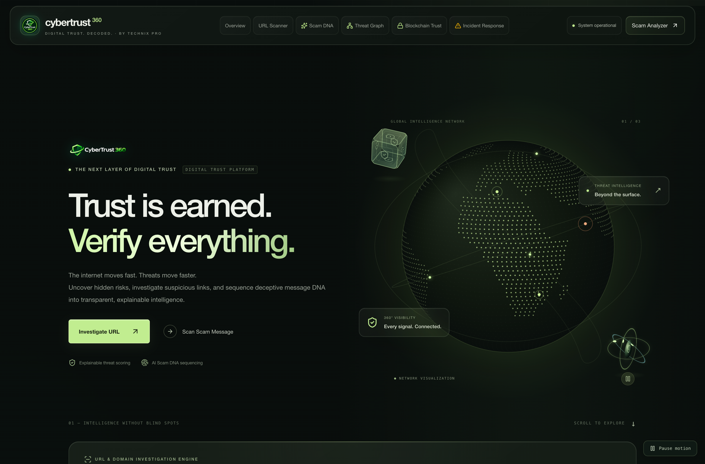
      <br><strong>1. Cinematic 3D Atmosphere & Security Dashboard</strong>
    </td>
    <td width="50%" align="center">
      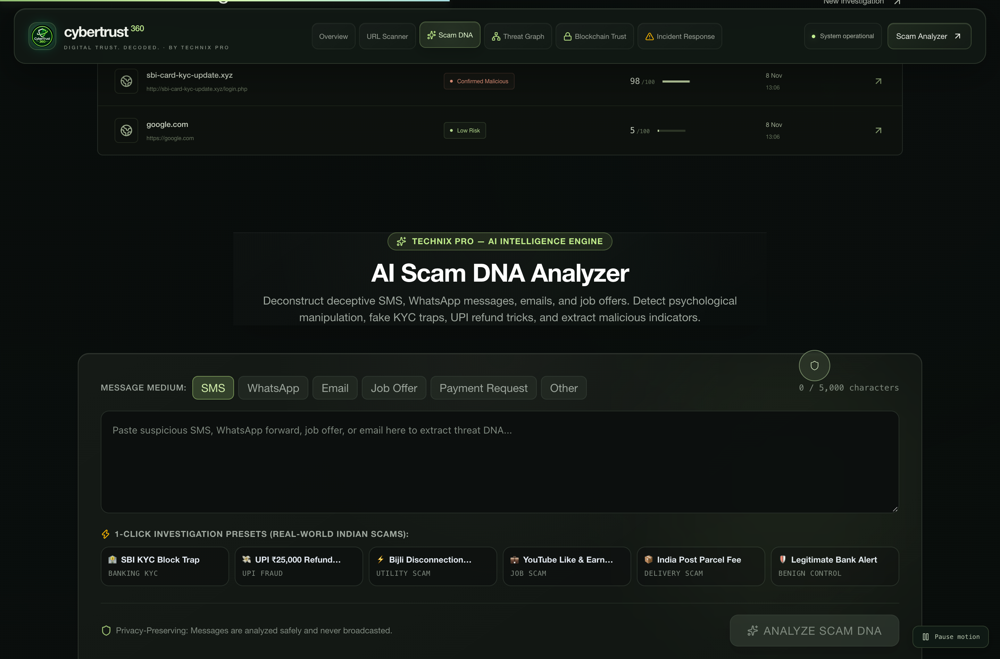
      <br><strong>2. Deep URL Forensics (Typosquatting & DNS Telemetry)</strong>
    </td>
  </tr>
  <tr>
    <td width="50%" align="center">
      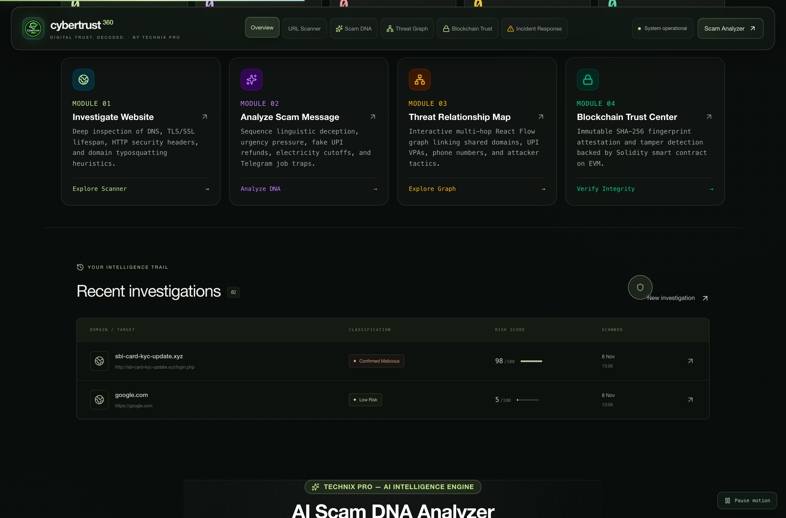
      <br><strong>3. AI Scam DNA Analysis & Indicator Extraction</strong>
    </td>
    <td width="50%" align="center">
      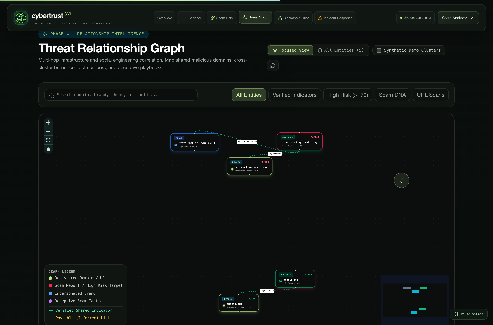
      <br><strong>4. Multi-Hop Threat Relationship Graph (@xyflow/react)</strong>
    </td>
  </tr>
  <tr>
    <td width="50%" align="center">
      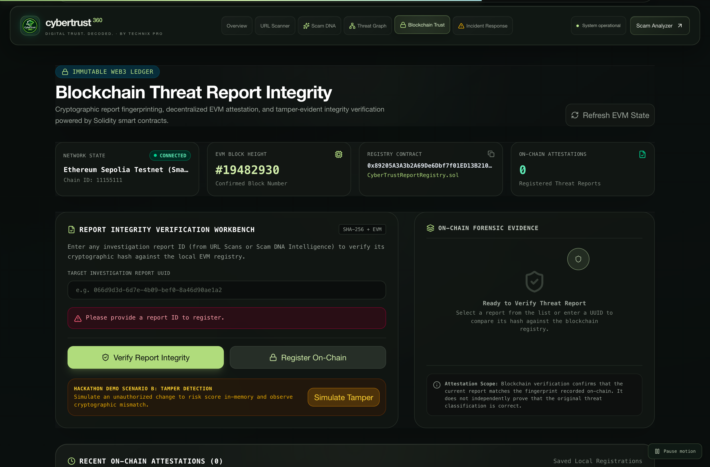
      <br><strong>5. Blockchain Trust Center (Scenario A: Verified)</strong>
    </td>
    <td width="50%" align="center">
      
      <br><strong>6. Real-Time Cryptographic Tamper Detection (Scenario B)</strong>
    </td>
  </tr>
  <tr>
    <td width="50%" align="center">
      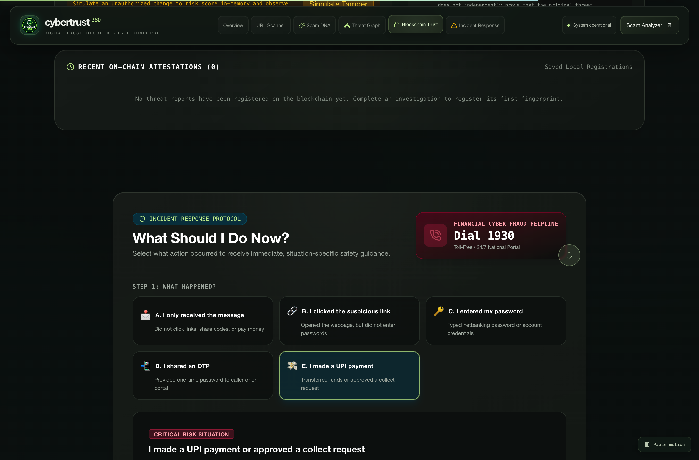
      <br><strong>7. Golden Hour Incident Response (Helpline 1930 Guidance)</strong>
    </td>
    <td width="50%" align="center">
      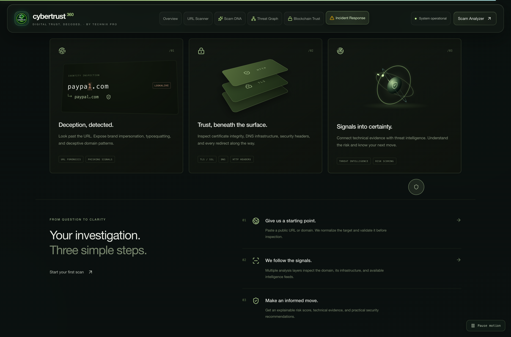
      <br><strong>8. Platform Telemetry Matrix & Audit Integrity</strong>
    </td>
  </tr>
</table>

---

## 🔐 Security, Privacy & Responsible AI Principles

- **Strict SSRF Defense**: All target URLs are resolved and validated against a strict denylist. Scanning loopback addresses (`127.0.0.1`, `localhost`), private subnets (`10.0.0.0/8`, `172.16.0.0/12`, `192.168.0.0/16`), link-local IPs, and cloud metadata endpoints (`169.254.169.254`) is strictly blocked before any HTTP connection is attempted.
- **Zero-PII On-Chain Guarantee**: The Solidity smart contract records exclusively `bytes32` hashes. No personally identifiable information (PII), raw messages, phone numbers, or bank account details are ever published to the public blockchain.
- **Transparent Fallback Attribution**: When live LLM APIs are not configured, the platform activates deterministic heuristic rules and **clearly labels them as rule-based analysis**—never fabricating fake AI responses.
- **Non-Intrusive Scanning Ethics**: CyberTrust 360 conducts only passive and non-invasive technical observation. It does not perform port exploitation, vulnerability injection, brute-forcing, or credential cracking.
- **Attribution Guardrail**: The platform explicitly informs users that shared technical indicators (e.g. shared server IP or phone number) demonstrate infrastructure reuse, not conclusive legal identity of the threat actor.

---

## 📂 Repository Structure

```text
CYBERTRUST-360/
├── .github/
│   └── workflows/
│       └── deploy-pages.yml          # Automated GitHub Pages CI/CD deployment
├── backend/
│   ├── alembic/                      # Database schema migrations
│   ├── app/
│   │   ├── api/v1/                   # FastAPI modular routes (scans, scam, graph, blockchain)
│   │   ├── core/                     # Configuration, database session, SSRF filters
│   │   ├── models/                   # SQLAlchemy ORM models (ScanRecord, ScamRecord, Report)
│   │   ├── schemas/                  # Pydantic v2 validation models
│   │   ├── services/                 # URL investigator, Scam DNA, graph builder, Web3 client
│   │   └── main.py                   # FastAPI application initialization & lifespan
│   ├── tests/                        # Pytest automated test suite (44+ tests)
│   └── requirements.txt              # Python production dependencies
├── blockchain/
│   ├── contracts/
│   │   └── CyberTrustReportRegistry.sol # Solidity 0.8.24 threat attestation registry
│   ├── scripts/
│   │   └── deploy.ts                 # Hardhat deployment script
│   ├── test/                         # Hardhat unit tests (13 tests)
│   ├── hardhat.config.ts             # Hardhat EVM network configuration
│   └── package.json                  # Web3 dependencies
├── docs/
│   ├── ARCHITECTURE.md               # Complete technical architectural specification
│   ├── PRESENTATION.md               # Hackathon slide content, demo script, and pitch
│   ├── DEMO_VIDEO_STORYBOARD.md      # Video recording storyboard & shot list
│   ├── CyberTrust360_PitchDeck.pptx  # 10-slide PowerPoint presentation
│   └── screenshots/                  # High-resolution platform capture gallery (19 artifacts)
├── frontend/
│   ├── public/                       # High-res logos, favicons, vector assets
│   ├── src/
│   │   ├── components/               # React components (Scanner, ScamDNA, Graph, TrustCenter)
│   │   ├── graphics/                 # WebGL sculpture & procedural atmosphere renderers
│   │   ├── services/                 # Typed API client services with timeout controllers
│   │   ├── App.tsx                   # Main application orchestrator
│   │   ├── cinematic.css             # 3D cinematic motion styles & custom pointer
│   │   └── index.css                 # Tailwind CSS v4 styling & glassmorphism
│   ├── package.json                  # Frontend dependencies
│   └── vite.config.ts                # Vite 8 bundler configuration
├── scripts/                          # Test helpers & deployment scripts
├── docker-compose.yml                # PostgreSQL 16 container definition
├── start_demo.sh                     # Verified one-command automated demo supervisor
├── PROJECT_CONTEXT.md                # Persistent architectural documentation
└── README.md                         # Project documentation & hackathon guide
```

---

## ⚡ Quick Start & Installation

### Prerequisites
- **Node.js**: v18.0.0+ (Node 20+ recommended)
- **Python**: v3.11.0+
- **Git**
- *(Optional)* Docker for local PostgreSQL

### Option 1: One-Command Startup (Recommended for Judges & Evaluators)

CyberTrust 360 includes an automated supervisor script that tests port availability, initializes the database, starts the local Hardhat blockchain, deploys the smart contract, boots FastAPI, and launches the Vite frontend:

```bash
# 1. Clone the repository
git clone https://github.com/sayanghosh67/CyberTrust-360.git
cd CyberTrust-360

# 2. Setup environment file
cp .env.example .env

# 3. Launch full stack with one command
chmod +x start_demo.sh
./start_demo.sh
```

Once running, navigate to:
- **Frontend Application**: [http://localhost:5173](http://localhost:5173)
- **Interactive Swagger Docs**: [http://localhost:8000/docs](http://localhost:8000/docs)
- **Backend Health Check**: [http://localhost:8000/api/health](http://localhost:8000/api/health)

---

### Option 2: Manual Step-by-Step Startup

If you prefer launching each service in separate terminal windows:

#### Terminal 1: Local Hardhat Blockchain
```bash
cd blockchain
npm install
npx hardhat node --hostname 127.0.0.1 --port 8545
```

#### Terminal 2: Deploy Smart Contract
```bash
cd blockchain
npx hardhat run scripts/deploy.ts --network localhost
```

#### Terminal 3: FastAPI Backend Server
```bash
python3 -m venv backend/.venv
source backend/.venv/bin/activate
pip install -r backend/requirements.txt
uvicorn backend.app.main:app --reload --host 127.0.0.1 --port 8000
```

#### Terminal 4: React + Vite Frontend
```bash
cd frontend
npm install
npm run dev -- --host 127.0.0.1 --port 5173
```

---

## 🧪 Automated Test Suite

The platform includes comprehensive test suites across the smart contract, backend services, and frontend build:

```bash
# 1. Run Blockchain Smart Contract Tests (13 tests)
cd blockchain && npx hardhat test

# 2. Run Backend Pytest Suite (44+ tests)
PYTHONPATH=. backend/.venv/bin/pytest backend/tests -v

# 3. Verify Frontend Production Build (Zero errors)
npm run build --prefix frontend
```

**Total Test Coverage**: **57/57 Automated Tests Passing** across all modules.

---

## 🎬 5-Minute Hackathon Demo Script

For evaluators reviewing CyberTrust 360 in 5 minutes:

| Time | Platform Area | Demonstration Action | Key Takeaway for Judges |
| :--- | :--- | :--- | :--- |
| **0:00 - 0:45** | **Hero & Overview** | Open `http://localhost:5173`. Show the 3D cinematic design, global threat globe, and live database telemetry counts. | Premium, high-contrast UI designed for security professionals and everyday citizens. |
| **0:45 - 1:45** | **URL Investigator** | Click preset `paypa1-account-login-update.com`. Run investigation. Inspect typosquatting flags, DNS A/MX records, and short TLS certificate lifespan. | Explainable 0–100 risk score backed by concrete technical evidence, not a black-box verdict. |
| **1:45 - 2:45** | **Scam DNA Analyzer** | Paste a synthetic Electricity Bill / KYC cutoff SMS. Review extracted burner phone number, urgency pressure score, and Indian fraud tactics. | Dual-mode AI with prompt injection fencing and transparent heuristic fallback. |
| **2:45 - 3:30** | **Threat Graph** | Open Threat Relationship Graph. Click a banking phishing node to highlight 1-hop connections. Inspect green verified edges vs amber inferred edges. | Connects isolated scam reports into actionable multi-hop intelligence clusters. |
| **3:30 - 4:30** | **Blockchain Trust** | Open Blockchain Trust Center. Verify report integrity on-chain (Scenario A). Click **"Simulate Tamper"** (Scenario B) to trigger cryptographic mismatch alert. | Real EVM Solidity smart contract with zero PII stored on-chain. |
| **4:45 - 5:00** | **Incident Guidance** | Open Golden Hour protocol. Review direct reporting steps for **National Helpline 1930** and **cybercrime.gov.in**. | Actionable victim protection when minutes matter most. |

---

## 👥 Team TECHNIX PRO & Acknowledgments

Built with dedication for the Hackathon by **Team TECHNIX PRO**:

- **Sayan Ghosh** — *Lead Full-Stack & Systems Architecture Engineer*  
  Architecture design, FastAPI backend, Web3 smart contract integration, deterministic hashing engine, and systems orchestration.
- **Sayani Ghosal** — *AI/ML & Scam Intelligence Research Engineer*  
  Scam DNA sequencing, prompt injection defense, Indian digital threat pattern modeling, and incident response design.
- **Hritushree Mitra** — *Threat Correlation & Graph Frontend Engineer*  
  React Flow graph architecture, multi-hop relationship modeling, evidence drawers, and interactive visual telemetry.
- **Swastika Paul** — *Cybersecurity, Security Hardening & QA Engineer*  
  SSRF containment, TLS/Header auditing logic, automated regression test suite, smart contract unit tests, and security audits.

---

## 📄 License & Disclaimers

This project is licensed under the **MIT License** — see the [LICENSE](LICENSE) file for details.

### Disclaimers
1. **Educational & Defensive Purpose**: CyberTrust 360 is designed exclusively for threat detection, research, and defensive digital awareness.
2. **Attestation Scope**: Blockchain attestation cryptographically verifies that a stored threat report matches the exact fingerprint registered at a given block time; it does not independently endorse third-party external indicators.
3. **No Guarantee of Fund Recovery**: Incident guidance accurately advises immediate reporting to India's National Helpline 1930 and bank channels to maximize the likelihood of account freezes, without making false guarantees of monetary recovery.

---

<p align="center">
  <strong>CyberTrust 360 — Your Digital World. Protected from Every Angle.</strong><br>
  Developed with ❤️ by <strong>TECHNIX PRO</strong>
</p>
