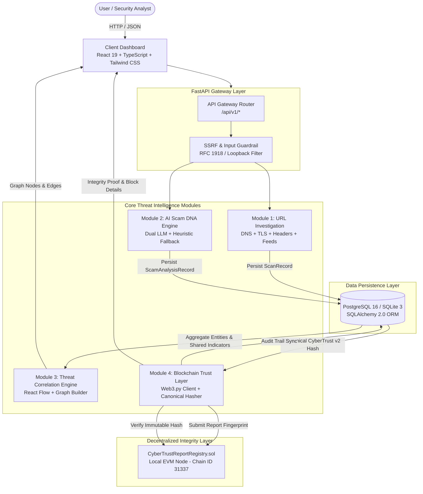

> Remediation update: use `start_demo.sh` for a localhost-only authenticated demo. Current behavior and verification results are in `CODEX_POST_REMEDIATION_REPORT.md`. Older screenshots, the original PPTX and the original video are historical captures.

# CyberTrust 360 — Technical Architecture Specification

> **Team**: TECHNIX PRO  
> **Project**: CyberTrust 360  
> **Tagline**: Your Digital World. Protected from Every Angle.  
> **Version**: 1.0.0 (Hackathon Release)  

---

## 1. Executive Architectural Overview

CyberTrust 360 is an integrated cybersecurity intelligence platform engineered to detect modern web threats, sequence linguistic deception patterns, map threat relationships across distributed scam campaigns, and provide tamper-proof on-chain auditability.



---

## 2. End-to-End Data Pipeline Flow

The end-to-end lifecycle follows an auditable 7-step pipeline:

```
[1. User Input] 
       │
       ▼
[2. Backend Analysis & Multi-Vector Inspection]
       │
       ▼
[3. Risk Evidence & Explainable Scoring (0–100)]
       │
       ▼
[4. Relational Database Persistence (PostgreSQL/SQLite)]
       │
       ▼
[5. Threat Relationship Correlation (Graph Clustering)]
       │
       ▼
[6. Canonical SHA-256 Hashing (CyberTrust v2)]
       │
       ▼
[7. On-Chain Smart Contract Registration & Integrity Verification]
```

1. **User Input**: A user submits an untrusted URL, domain, or suspicious message (SMS, WhatsApp forward, UPI payment request).
2. **Backend Analysis & Multi-Vector Inspection**:
   - URLs undergo strict SSRF sanitization, DNS resolution (A, AAAA, MX, TXT, NS), SSL/TLS lifespan verification, security header auditing, and threat intelligence lookups (Google Safe Browsing, URLhaus).
   - Messages undergo linguistic parsing, urgency pressure calculation, Indian fraud pattern matching (UPI PIN, KYC, utility cutoffs), and prompt injection isolation.
3. **Risk Evidence & Explainable Scoring**: An explainable 0–100 composite score is calculated with granular, readable evidence items and actionable defensive guidance.
4. **Relational Database Persistence**: Reports are persisted in PostgreSQL 16 (or local SQLite fallback `./cybertrust.db` if Docker is offline) with full structured JSON telemetry.
5. **Threat Relationship Correlation**: The graph correlation engine queries database records to extract shared technical indicators (domains, IPs, phone numbers, UPI VPAs) and playbook patterns, constructing interactive multi-hop clusters.
6. **Canonical SHA-256 Hashing**: The report is serialized into CyberTrust v2 canonical JSON (recursively sorted keys, the complete saved report and summary columns) and hashed using SHA-256 to create an immutable 32-byte cryptographic fingerprint (`bytes32`).
7. **On-Chain Smart Contract Registration & Integrity Verification**: The fingerprint is committed to `CyberTrustReportRegistry.sol` on an EVM blockchain. Any future audit queries the contract to verify whether the report remains unchanged or has been tampered with.

---

## 3. Technology Stack & Architectural Specifications

### 3.1 Frontend Architecture
- **Framework**: React 19 (TypeScript, strict mode, `verbatimModuleSyntax`)
- **Styling**: Tailwind CSS v4 (`@tailwindcss/vite`) with dark cybersecurity aesthetic
- **State & Networking**: Native async fetch clients with `AbortController` timeout protection (20s ceiling for deep scans, 6s for health probes)
- **Graph Visualization**: `@xyflow/react` (React Flow) with customized node types, force-spaced layouts, dynamic neighborhood highlighting, and evidence panels
- **Component Design**: Modular, reusable cards with ARIA labels, responsive viewports, and keyboard accessibility

### 3.2 Backend Gateway & Micro-Services
- **Runtime**: Python 3.11+
- **Framework**: FastAPI (v0.162.0+) with Pydantic v2 schemas
- **Concurrency**: Asynchronous `asyncio.gather` for non-blocking concurrent inspection of DNS, TLS, headers, and threat feeds
- **Security Guardrails**:
  - `is_target_host_blocked`: Blocks loopback (`127.0.0.0/8`, `::1`), private subnets (`10.0.0.0/8`, `172.16.0.0/12`, `192.168.0.0/16`), cloud metadata (`169.254.169.254`), carrier-grade NAT, and internal domains
  - Per-hop redirect validation in `headers_checker.py` ensuring no redirect hop can target private networks
- **Error Boundaries**: Exception isolation ensures failure of an external threat feed does not fail the primary investigation

### 3.3 AI Scam DNA Intelligence & Heuristic Fallback
- **Linguistic Sequencing Engine**: Identifies manipulation tactics, brand impersonation, urgency triggers, and financial coercion
- **Indian Cyber Fraud Specialization**: Tailored detection for fake bank KYC account blocks, UPI PIN inversion fraud, electricity bill cutoff threats, and Telegram task scams
- **Prompt Injection Defense**: Untrusted message inputs are wrapped in `<untrusted_user_message>` delimiters with strict instruction isolation
- **Dual AI & Deterministic Fallback**: Supports Gemini and OpenAI models via environment variables. When keys are absent, seamlessly activates the deterministic rule engine with 100% honest attribution (`rule_based_fallback`)

### 3.4 Threat Relationship Graph
- **Entity Model**: 7 node categories (`scam_report`, `url_scan`, `domain`, `url`, `brand`, `tactic`, `indicator`)
- **Edge Classification**:
  - `VERIFIED_SHARED_INDICATOR` (Solid Green): Direct technical matches (shared domain, identical URL, shared phone, shared UPI VPA)
  - `POSSIBLE_RELATIONSHIP` (Dashed Amber): Inferred heuristic connections based on shared deceptive tactics or brand impersonation
- **Anti-Overlap Layout**: Force-directed placement algorithm maintaining minimum node separation distance
- **Attribution Guardrail**: Embedded legal disclaimer stating shared indicators demonstrate infrastructure reuse, not proof of identical criminal identity

### 3.5 Blockchain Integrity Layer
- **Smart Contract**: `CyberTrustReportRegistry.sol` (Solidity 0.8.24, Paris EVM target)
- **Network**: Local Hardhat EVM (Chain ID 31337) on `http://127.0.0.1:8545`
- **Zero-PII On-Chain Storage**:
  ```solidity
  struct ReportRecord {
      bytes32 reportIdHash;
      bytes32 contentHash;
      string reportType;
      uint256 version;
      uint256 registeredAt;
      address registrar;
  }
  ```
- **Integrity Verification**:
  - Matching hash: `VERIFIED — REPORT UNCHANGED`
  - Mismatched hash: `MISMATCH — REPORT MODIFIED` (triggers cryptographic security alert)
- **Attestation Scope Disclaimer**: Confirms record matches on-chain fingerprint at registration time; does not prove original threat assessment accuracy

### 3.6 Data Persistence & Resilient Fallback
- **Primary Database**: PostgreSQL 16 Alpine via Docker Compose
- **Zero-Downtime Fallback**: SQLite 3 (`./cybertrust.db`) when Docker or PostgreSQL is offline
- **Schema Management**: SQLAlchemy 2.0 ORM with Alembic migrations

---

## 4. Verification & Testing Evidence

- **Smart Contract Tests**: 13/13 passing (`CI=true npx hardhat test`)
- **Backend Tests**: 45/45 passing (`PYTHONPATH=. backend/.venv/bin/pytest backend/tests -v`)
- **Total Automated Tests**: **See CODEX_POST_REMEDIATION_REPORT.md**
- **Frontend Production Build**: Zero TypeScript errors (`tsc -b && vite build`)
- **One-Command Startup**: Fully verified via `./start_demo.sh`

